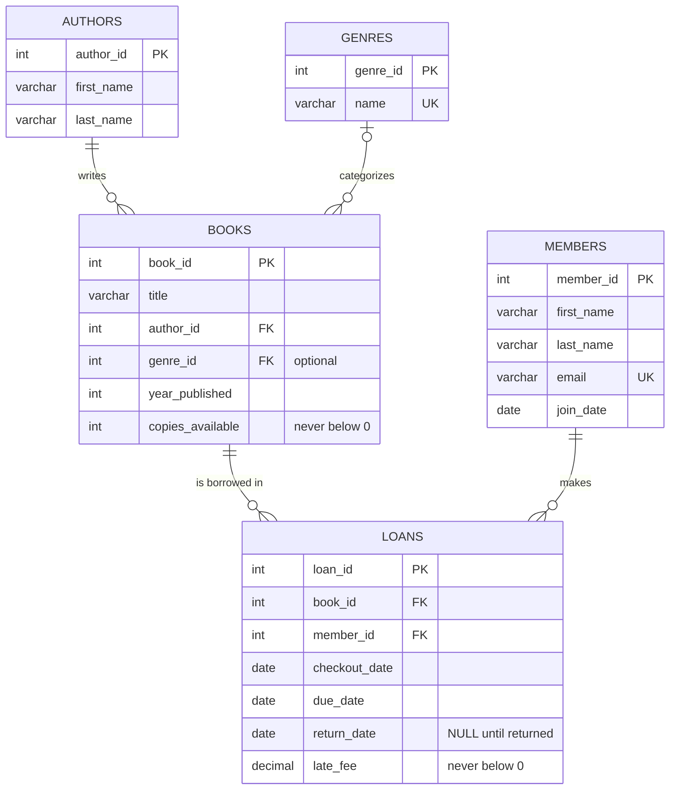

# Overview

As a software engineer, I wanted to learn how to design a relational database and build a program that works with it through SQL. Relational databases are used in almost every business application, so I focused on the skills behind them: designing normalized tables, connecting them with primary and foreign keys, writing JOIN and aggregate queries, and sending SQL safely from code.

To practice these skills, I built **Library Catalog**, a Python command-line program that manages a small library. All of its data is stored in a MySQL database. The program builds SQL commands, sends them to MySQL with parameterized queries, and uses the results to show lists, tables, and reports. With it, a user can:

* **Books:** add, list, search (by title, author, or genre), update, and delete books
* **Members:** add, list, and delete library members (each email can be used only once)
* **Loans:** check out a book (due in 14 days), return it (a late fee of $0.25 per day is calculated automatically), and see which books are checked out and which are overdue
* **Reports:** books per genre, books per author, member activity, and loan statistics, using the aggregate functions COUNT, AVG, and SUM

**How to run the program**

1. Install MySQL Server and make sure it is running.
2. Create a virtual environment and install the library:
```
   uv venv
   source .venv/bin/activate
   uv pip install -r requirements.txt
```
3. (Optional) Load the sample data. Answer `y` to start from a clean database:
```
   python load_sample_data.py
```
4. Start the program and enter your MySQL password when asked:
```
   python library_catalog.py
```
   The program creates the database and tables automatically from `schema.sql` the first time it runs. The password is never stored in the code; it can also be set in the `MYSQL_PASSWORD` environment variable.

My purpose for writing this software was to learn how to design a relational database from scratch and how a program talks to it: creating tables, inserting, retrieving, updating, and deleting rows, joining related tables, summarizing data, and handling errors and bad input without crashing.

[Software Demo Video](http://youtube.link.goes.here)

# Relational Database

The program uses **MySQL Community Server**, a relational database that stores data in tables with rows and columns. Relationships between tables are made with primary keys and foreign keys, and the data is read and changed with SQL.

The `library_catalog` database has **five related tables**:

| Table | What it stores | Key relationships |
|---|---|---|
| `authors` | One row per author (first and last name) | Referenced by `books` |
| `genres` | One row per genre; each name is UNIQUE | Referenced by `books` |
| `books` | Title, year, and number of copies available | Foreign keys to `authors` and `genres` |
| `members` | Name, email (UNIQUE), and join date | Referenced by `loans` |
| `loans` | Checkout date, due date, return date, and late fee | Foreign keys to `books` and `members` |

**Entity Relationship (ER) diagram**



How to read the diagram: one author writes many books, one genre categorizes many books (a book may have no genre), and each loan connects one book with one member.

**Design decisions**

* **Normalization:** authors and genres have their own tables, so each name is stored only once. A book stores only the ID of its author and genre.
* **Data integrity:** foreign keys stop a book from pointing to an author that does not exist, and CHECK constraints stop impossible values (for example, negative copies, or a due date before the checkout date).
* **Parameterized queries:** every query sends user input separately from the SQL with `%s` placeholders, which protects the database from SQL injection.
* **Transactions:** checking out or returning a book changes two tables (`loans` and `books`). Both changes are saved together with one `commit()`, and `rollback()` undoes them if anything fails.

# Development Environment

* **Visual Studio Code** - code editor
* **MySQL Community Server 26.10** - the database server, running locally
* **MySQL Workbench** - to test SQL queries before adding them to Python and to look at the data
* **Git and GitHub** - version control
* **uv** - to create a Python virtual environment and install packages

The program is written in **Python 3.13** and uses these libraries:

* **mysql-connector-python** - the official MySQL driver for Python, used to connect, send SQL, and read results
* **datetime** - from the Python standard library, used for checkout dates, due dates, and late fees
* **getpass** and **os** - from the Python standard library, used to ask for the database password without showing it or storing it in the code

# Useful Websites

- [MySQL 8.4 Reference Manual](https://dev.mysql.com/doc/refman/8.4/en/)
- [MySQL Connector/Python Developer Guide](https://dev.mysql.com/doc/connector-python/en/)
- [W3Schools SQL Tutorial](https://www.w3schools.com/sql/)
- [Mermaid Entity Relationship Diagrams](https://mermaid.js.org/syntax/entityRelationshipDiagram.html)
- [GitHub Docs - Creating Diagrams](https://docs.github.com/en/get-started/writing-on-github/working-with-advanced-formatting/creating-diagrams)

# Future Work

- Let a member check out several books at once and limit how many books one member can borrow
- Add a report that filters loans by a date range (for example, all checkouts in October)
- Add user accounts so librarians log in with their own MySQL user instead of root
- Mark late fees as paid and show each member's unpaid balance
- Build a web or graphical interface instead of the command-line menu